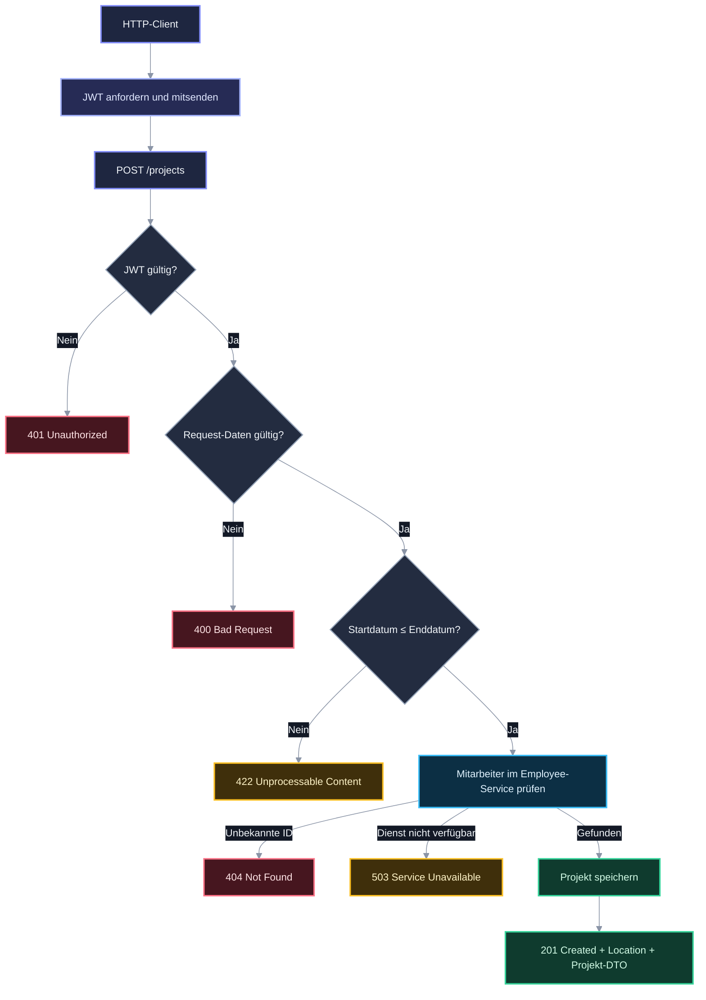

<style>
/* =====================================================
   ERZWUNGENES DARK-LAYOUT (unabhängig vom VS-Code-Theme)
   ===================================================== */
:root {
  --page: #0d1117;
  --card: #161c28;
  --card-2: #1b2232;
  --hover: #212a3d;
  --line: #2a3346;
  --text: #e6edf3;
  --muted: #8b95a7;
  --primary: #818cf8;
  --primary-soft: rgba(129,140,248,.14);
  --ok: #34d399;   --ok-soft: rgba(52,211,153,.14);
  --cond: #38bdf8; --cond-soft: rgba(56,189,248,.14);
  --found: #a5b4fc;--found-soft: rgba(165,180,252,.14);
  --hist: #fbbf24; --hist-soft: rgba(251,191,36,.14);
  --sup: #94a3b8;  --sup-soft: rgba(148,163,184,.14);
  --disp: #fb7185; --disp-soft: rgba(251,113,133,.14);
  --unv: #c084fc;  --unv-soft: rgba(192,132,252,.14);
  --grpA: #818cf8; --grpB: #f472b6; --grpC: #2dd4bf;
  --tl-line: linear-gradient(to bottom, transparent 0%, #3b4270 8%, #818cf8 50%, #3b4270 92%, transparent 100%);
  --shadow: 0 2px 14px rgba(0,0,0,.35);
  --radius: 12px;
  --font: "Segoe UI Variable", "Segoe UI", -apple-system, system-ui, Roboto, "Helvetica Neue", sans-serif;
}
html, body, body.vscode-light, body.vscode-dark, body.vscode-high-contrast {
  background: var(--page) !important;
  color: var(--text) !important;
  font-family: var(--font) !important;
}
body a { color: #93c5fd !important; }
body h1 { color: #fff !important; border-bottom: 2px solid var(--primary) !important; padding-bottom: 6px; }
body h2 { color: #fff !important; border-bottom: 1px solid var(--line) !important; padding-bottom: 5px; margin-top: 30px; }
body h3 { color: #c7d2fe !important; margin-top: 22px; }
body hr { border: 0 !important; height: 1px !important; background: linear-gradient(90deg, transparent, var(--line), transparent) !important; margin: 30px 0 !important; }
body code { background: #1f2738 !important; color: #fcd34d !important; padding: 1px 6px; border-radius: 5px; }
body pre { background: #111723 !important; border: 1px solid var(--line) !important; border-radius: 10px !important; }
body pre code { color: #d1d5db !important; background: transparent !important; }
body blockquote { background: var(--primary-soft) !important; border-left: 4px solid var(--primary) !important; color: var(--text) !important; border-radius: 0 10px 10px 0; padding: 10px 16px !important; margin: 12px 0 18px !important; }
body strong, body b { color: #fff; }
small, .muted { color: var(--muted) !important; }

/* ============ TABELLEN ============ */
body table {
  width: 100%; border-collapse: separate !important; border-spacing: 0 !important;
  border: 1px solid var(--line) !important; border-radius: 12px !important; overflow: hidden;
  background: var(--card) !important; font-size: .86rem; margin: 10px 0 20px !important;
  box-shadow: var(--shadow);
}
body table th {
  background: #1d2540 !important; color: #c7d2fe !important; text-align: left;
  font-size: .7rem !important; text-transform: uppercase; letter-spacing: .07em; font-weight: 700 !important;
  padding: 11px 12px !important; border: none !important; border-bottom: 2px solid #3b4a7a !important;
}
body table td {
  padding: 10px 12px !important; border: none !important; border-bottom: 1px solid var(--line) !important;
  color: var(--text) !important; vertical-align: top;
}
body table tbody tr:nth-child(even) td { background: rgba(255,255,255,.025) !important; }
body table tbody tr:hover td { background: rgba(129,140,248,.10) !important; }
body table tbody tr:last-child td { border-bottom: none !important; }
body table td:first-child { font-weight: 600; color: #fff !important; }

/* Formel-Tabelle */
.ftab td.fx { font-family: Consolas, "Cascadia Code", monospace; font-size: .8rem; color: #fde68a !important; }
.ftab tr.k-rend td:first-child { box-shadow: inset 4px 0 0 var(--ok); }
.ftab tr.k-kost td:first-child { box-shadow: inset 4px 0 0 var(--hist); }
.ftab tr.k-fin  td:first-child { box-shadow: inset 4px 0 0 var(--cond); }
.ftab tr.k-cf   td:first-child { box-shadow: inset 4px 0 0 var(--unv); }
.ftab tr.k-risk td:first-child { box-shadow: inset 4px 0 0 var(--disp); }

/* Heatmap */
.heat td.y { background: var(--ok-soft) !important; color: var(--ok) !important; font-weight: 600; }
.heat td.c { background: var(--cond-soft) !important; color: var(--cond) !important; }
.heat td.h { background: var(--hist-soft) !important; color: var(--hist) !important; font-weight: 600; }
.heat td.r { background: var(--disp-soft) !important; color: var(--disp) !important; }

/* ============ MERMAID (erzwungen dunkel) ============ */
.mermaid, pre.mermaid, div.mermaid {
  background: #131926 !important; border: 1px solid var(--line) !important; border-radius: 14px !important;
  padding: 18px !important; margin: 10px 0 20px !important;
}
.mermaid .nodeLabel, .mermaid .label, .mermaid span { color: #f1f5f9 !important; }
.mermaid .edgeLabel, .mermaid .edgeLabel p, .mermaid .edgeLabel span { background: #131926 !important; color: #cbd5e1 !important; }
.mermaid .edgeLabel rect { fill: #131926 !important; }
.mermaid .flowchart-link, .mermaid .edgePath path { stroke: #8b95a7 !important; }
.mermaid .cluster rect { fill: #111723 !important; }
.mermaid .cluster-label span, .mermaid .cluster text { color: #e6edf3 !important; fill: #e6edf3 !important; }

/* ============ HERO / PILLS ============ */
.hero { border-radius: 16px; padding: 22px 26px; margin: 6px 0 22px; font-family: var(--font);
  background: radial-gradient(120% 140% at 0% 0%, #4338ca 0%, #6d28d9 45%, #be185d 100%); color: #fff; box-shadow: var(--shadow); }
.hero h2 { margin: 0 0 6px !important; border: none !important; color: #fff !important; font-size: 1.5rem; padding: 0 !important; }
.hero p { margin: 0; opacity: .92; }
.hero .chips span { display: inline-block; margin: 10px 6px 0 0; padding: 3px 10px; border-radius: 999px; background: rgba(255,255,255,.16); font-size: .8rem; }
.pill { display: inline-block; padding: 2px 9px; border-radius: 999px; font-size: .72rem; font-weight: 700; white-space: nowrap; border: 1px solid transparent; }
.p-ok   { background: var(--ok-soft);   color: var(--ok);   border-color: rgba(52,211,153,.35); }
.p-cond { background: var(--cond-soft); color: var(--cond); border-color: rgba(56,189,248,.35); }
.p-found{ background: var(--found-soft);color: var(--found);border-color: rgba(165,180,252,.35); }
.p-hist { background: var(--hist-soft); color: var(--hist); border-color: rgba(251,191,36,.35); }
.p-sup  { background: var(--sup-soft);  color: var(--sup);  border-color: rgba(148,163,184,.35); }
.p-disp { background: var(--disp-soft); color: var(--disp); border-color: rgba(251,113,133,.35); }
.p-unv  { background: var(--unv-soft);  color: var(--unv);  border-color: rgba(192,132,252,.35); }
.p-A { background: rgba(129,140,248,.15); color: var(--grpA); }
.p-B { background: rgba(244,114,182,.15); color: var(--grpB); }
.p-C { background: rgba(45,212,191,.15); color: var(--grpC); }
.legend { display: flex; flex-wrap: wrap; gap: 6px; margin: 6px 0 16px; }

/* ============ KPI / PANELS ============ */
.kpis { display: grid; grid-template-columns: repeat(auto-fit, minmax(160px, 1fr)); gap: 12px; margin-bottom: 18px; font-family: var(--font); }
.kpi { background: var(--card); border: 1px solid var(--line); border-radius: var(--radius); padding: 14px 16px; box-shadow: var(--shadow); border-top: 3px solid var(--kc, var(--primary)); }
.kpi .v { font-size: 1.7rem; font-weight: 700; color: var(--kc, var(--primary)); line-height: 1.1; }
.kpi .l { font-size: .84rem; font-weight: 600; margin-top: 4px; color: var(--text); }
.kpi .s { font-size: .75rem; color: var(--muted); margin-top: 3px; }
.grid2 { display: grid; grid-template-columns: repeat(auto-fit, minmax(280px, 1fr)); gap: 14px; margin-bottom: 16px; font-family: var(--font); }
.panel { background: var(--card); border: 1px solid var(--line); border-radius: var(--radius); padding: 16px 18px; box-shadow: var(--shadow); }
.panel h4 { margin: 0 0 12px; font-size: .95rem; color: #fff; }

/* Donut */
.donut-row { display: flex; align-items: center; gap: 18px; flex-wrap: wrap; }
.donut { width: 128px; height: 128px; border-radius: 50%; position: relative; flex: 0 0 auto; }
.donut::after { content: ""; position: absolute; inset: 22px; border-radius: 50%; background: var(--card); }
.donut b { position: absolute; inset: 0; display: flex; align-items: center; justify-content: center; z-index: 1; font-size: 1.35rem; flex-direction: column; color: #fff; }
.donut b small { font-size: .65rem; font-weight: 500; }
.dl { list-style: none; margin: 0; padding: 0; font-size: .82rem; }
.dl li { display: flex; align-items: center; gap: 8px; margin: 4px 0; }
.dl i { width: 10px; height: 10px; border-radius: 3px; display: inline-block; }

/* Balken */
.bars { font-size: .82rem; }
.bar-row { display: grid; grid-template-columns: 170px 1fr 58px; align-items: center; gap: 10px; margin: 8px 0; }
.bar { height: 10px; background: #0f1420; border: 1px solid var(--line); border-radius: 999px; overflow: hidden; }
.bar > span { display: block; height: 100%; border-radius: 999px; background: var(--bc, var(--primary)); box-shadow: 0 0 10px var(--bc, var(--primary)); }
.bar-row .n { text-align: right; font-weight: 700; font-variant-numeric: tabular-nums; color: #fff; }

/* Dots-Rating */
.dots { letter-spacing: 2px; color: var(--primary); white-space: nowrap; }
.dots .off { color: #2f3850; }

/* ============ QUADRANT (HTML) ============ */
.quad-wrap { font-family: var(--font); background: #131926; border: 1px solid var(--line); border-radius: 14px; padding: 16px 16px 34px 44px; position: relative; margin: 10px 0 20px; box-shadow: var(--shadow); }
.quad { position: relative; height: 360px; display: grid; grid-template-columns: 1fr 1fr; grid-template-rows: 1fr 1fr; border-radius: 10px; overflow: hidden; border: 1px solid var(--line); }
.quad > div.q { padding: 10px 12px; font-size: .74rem; font-weight: 700; letter-spacing: .05em; text-transform: uppercase; }
.q2 { background: rgba(129,140,248,.08); color: #a5b4fc; }
.q1 { background: rgba(251,113,133,.08); color: #fda4af; text-align: right; }
.q3 { background: rgba(148,163,184,.05); color: #94a3b8; display: flex; align-items: flex-end; }
.q4 { background: rgba(251,191,36,.07); color: #fcd34d; display: flex; align-items: flex-end; justify-content: flex-end; }
.pt { position: absolute; transform: translate(-50%, 50%); display: flex; align-items: center; gap: 6px; font-size: .78rem; font-weight: 600; color: #fff; white-space: nowrap; }
.pt i { width: 13px; height: 13px; border-radius: 50%; background: var(--pc); box-shadow: 0 0 0 3px rgba(19,25,38,1), 0 0 12px var(--pc); display: inline-block; }
.pt.l { flex-direction: row-reverse; transform: translate(calc(-100% + 6px), 50%); }
.ax-x { position: absolute; left: 44px; right: 16px; bottom: 8px; display: flex; justify-content: space-between; font-size: .72rem; color: var(--muted); }
.ax-y { position: absolute; left: 6px; top: 16px; bottom: 34px; width: 30px; display: flex; flex-direction: column; justify-content: space-between; align-items: center; font-size: .72rem; color: var(--muted); writing-mode: vertical-rl; transform: rotate(180deg); }

/* ============ WATERFALL ============ */
.wf { font-family: var(--font); background: #131926; border: 1px solid var(--line); border-radius: 14px; padding: 16px 18px; margin: 10px 0 20px; box-shadow: var(--shadow); }
.wf-row { display: grid; grid-template-columns: 220px 1fr 92px; gap: 12px; align-items: center; margin: 7px 0; font-size: .84rem; }
.wf-row .t { position: relative; height: 22px; background: repeating-linear-gradient(90deg, transparent 0 calc(10% - 1px), #1e2636 calc(10% - 1px) 10%); border-radius: 6px; }
.wf-row .t span { position: absolute; top: 0; bottom: 0; border-radius: 6px; }
.wf-row .v { text-align: right; font-weight: 700; font-variant-numeric: tabular-nums; }
.wf-row.sum { border-top: 1px dashed var(--line); padding-top: 8px; }
.wf-row.sum .lab { font-weight: 700; color: #fff; }
.pos { background: linear-gradient(90deg, #059669, #34d399); }
.neg { background: repeating-linear-gradient(135deg, #fb7185 0 6px, #e11d48 6px 12px); opacity: .9; }
.noi { background: linear-gradient(90deg, #4f46e5, #818cf8); }
.cap { background: repeating-linear-gradient(135deg, #fbbf24 0 6px, #d97706 6px 12px); }
.cfs { background: linear-gradient(90deg, #0284c7, #38bdf8); }

/* ============ CLUSTER (Krisenmuster) ============ */
.clus { display: grid; grid-template-columns: repeat(auto-fit, minmax(230px, 1fr)); gap: 14px; font-family: var(--font); margin: 10px 0 18px; }
.cl { background: var(--card); border: 1px solid var(--line); border-radius: 12px; padding: 14px 16px; border-top: 3px solid var(--cc); box-shadow: var(--shadow); }
.cl h4 { margin: 0 0 4px; color: var(--cc); font-size: .95rem; }
.cl .sub { font-size: .75rem; color: var(--muted); margin-bottom: 10px; }
.cl ul { list-style: none; margin: 0; padding: 0; }
.cl li { display: flex; justify-content: space-between; gap: 8px; align-items: center; padding: 7px 0; border-bottom: 1px solid var(--line); font-size: .84rem; }
.cl li:last-child { border-bottom: none; }
.cl li code { font-size: .72rem; }

/* ============ GANTT (HTML) ============ */
.gantt { font-family: var(--font); background: #131926; border: 1px solid var(--line); border-radius: 14px; padding: 14px 18px; margin: 10px 0 20px; box-shadow: var(--shadow); }
.g-axis, .g-row { display: grid; grid-template-columns: 230px 1fr; gap: 12px; align-items: center; }
.g-ticks { position: relative; height: 20px; border-bottom: 1px solid var(--line); }
.g-ticks i { position: absolute; font-style: normal; font-size: .7rem; color: var(--muted); transform: translateX(-50%); }
.g-row { margin: 7px 0; font-size: .82rem; }
.g-track { position: relative; height: 22px; background: repeating-linear-gradient(90deg, transparent 0 calc(12.5% - 1px), #1e2636 calc(12.5% - 1px) 12.5%); border-radius: 6px; }
.g-bar { height: 100%; border-radius: 6px; background: linear-gradient(90deg, transparent, var(--gc)); position: relative; border-right: 3px solid var(--gc); }
.g-bar b { position: absolute; right: 6px; top: 2px; font-size: .72rem; color: #0d1117; background: var(--gc); padding: 1px 6px; border-radius: 4px; }

/* ============ FLOW (HTML-Stepper) ============ */
.chart { background: #131926; border: 1px solid var(--line); border-radius: 14px; padding: 12px; margin: 10px 0 8px; box-shadow: var(--shadow); }
.chart-legend { display: flex; flex-wrap: wrap; gap: 14px; font-size: .8rem; margin: 6px 0 18px; font-family: var(--font); }
.chart-legend span { display: inline-flex; align-items: center; gap: 6px; }
.chart-legend i { width: 18px; height: 4px; border-radius: 2px; display: inline-block; }

/* ============ TIMELINE (Lieblingsstil) ============ */
.tl { position: relative; list-style: none; margin: 0 0 18px; padding: 0 8px 0 52px; font-family: var(--font); font-size: .9rem; line-height: 1.5; }
.tl::before { content: ""; position: absolute; top: 0; bottom: 0; left: 20px; width: 2px; background: var(--tl-line); }
.tl > li { position: relative; margin: 0 0 14px; padding: 14px 18px; background: var(--card); border: 1px solid var(--line); border-left: 4px solid var(--dot, var(--primary)); border-radius: var(--radius); box-shadow: var(--shadow); transition: background .15s, transform .15s; }
.tl > li:last-child { margin-bottom: 0; }
.tl > li:hover { background: var(--hover); transform: translateX(2px); }
.tl > li::before { content: ""; position: absolute; top: 18px; left: -32px; width: 14px; height: 14px; border-radius: 50%; transform: translateX(-50%); background: var(--dot, var(--primary)); border: 3px solid var(--page); box-shadow: 0 0 0 2px var(--dot, var(--primary)), 0 0 12px var(--dot, var(--primary)); }
.tl > li::after { content: ""; position: absolute; top: 24px; left: -25px; width: 21px; height: 2px; background: var(--dot, var(--primary)); opacity: .5; }
.tl h4 { margin: 0 0 6px; font-size: 1rem; font-weight: 650; color: var(--dot, var(--primary)); display: flex; flex-wrap: wrap; align-items: center; gap: 8px; }
.tl p { margin: 0 0 2px; color: var(--text); }
.tl .meta { margin-top: 8px; font-size: .78rem; color: var(--muted); display: flex; flex-wrap: wrap; gap: 6px 14px; }
.tl .date { font-size: .74rem; font-weight: 700; color: #e6edf3; background: #232c40; border: 1px solid var(--line); padding: 1px 8px; border-radius: 6px; }
.tl .fb { margin-top: 8px; padding-top: 8px; border-top: 1px dashed var(--line); font-size: .78rem; color: var(--muted); }
.tl > li.ok { --dot: var(--ok); } .tl > li.cond { --dot: var(--cond); } .tl > li.found { --dot: var(--found); }
.tl > li.hist { --dot: var(--hist); } .tl > li.sup { --dot: var(--sup); } .tl > li.disp { --dot: var(--disp); }
.tl > li.unv { --dot: var(--unv); } .tl > li.A { --dot: var(--grpA); } .tl > li.B { --dot: var(--grpB); } .tl > li.C { --dot: var(--grpC); }

/* Callouts */
.note { font-family: var(--font); border-radius: 10px; padding: 12px 16px; margin: 10px 0 16px; font-size: .88rem; background: var(--primary-soft); border-left: 4px solid var(--primary); color: var(--text); }
.note.warn { background: var(--hist-soft); border-left-color: var(--hist); }
.note.bad  { background: var(--disp-soft); border-left-color: var(--disp); }
details { margin: 8px 0; background: var(--card); border: 1px solid var(--line); border-radius: 10px; padding: 8px 14px; }
summary { cursor: pointer; font-weight: 600; color: var(--primary); }

@media (max-width: 700px) {
  .bar-row { grid-template-columns: 110px 1fr 48px; }
  .wf-row { grid-template-columns: 120px 1fr 70px; }
  .g-axis, .g-row { grid-template-columns: 130px 1fr; }
}
</style>

<div class="hero">
<h2>Projekt-API</h2>
<p>Ausführbare HTTP-Beispiele und API-Vertrag für Projekte anlegen und abrufen.</p>
<div class="chips"><span>Stand: 28.10.2026</span><span>Scope: /projects</span><span>HTTP Client: IntelliJ</span><span>Vorschau: Ctrl+Shift+V</span></div>
</div>

<div class="legend"><span class="pill p-ok">201 / 200 · Erfolg</span><span class="pill p-cond">JWT erforderlich</span><span class="pill p-disp">400 / 404 / 422 · Eingabe oder Ressource</span><span class="pill p-hist">503 · Abhängigkeit nicht verfügbar</span></div>

## Inhalt

| Bereich | Inhalt |
|---|---|
| [Kurzbeschreibung](#1-kurzbeschreibung) | Umfang und Ausführung der Beispiele |
| [Implementation](#2-implementation) | Request-Ablauf und Statuscodes |
| [Backend](#3-backend) | Felder, Antworten und Quellcode |
| [Manuelle Prüfung](#4-manuelle-pruefung) | Konkrete Aufrufe und erwartete Ergebnisse |

## 1. Kurzbeschreibung

Die geschützte Projekt-API kann Projekte anlegen und alle gespeicherten Projekte abrufen. Beim Anlegen werden Eingabedaten und Zeitraum geprüft; außerdem muss der verantwortliche Mitarbeiter im Employee-Service existieren.

Die fokussierten Beispiele liegen in [projects.http](../src/main/java/de/szut/lf8_starter/requests/projects.http). Dort wird das JWT im ersten Request angefordert und als `jwtToken` gespeichert.

> **Vorschau:** Für das vollständige Layout die Markdown-Vorschau in IntelliJ oder VS Code öffnen. In VS Code: `Ctrl+Shift+V`; für Mermaid-Diagramme die Erweiterung `bierner.markdown-mermaid` verwenden.

> 💬 **Rückmeldung:** ☐ passt ☐ ändern ☐ ablehnen · Anmerkungen: …

## 2. Implementation

### Ablauf eines Projekt-POSTs



### Endpunkte und Ergebnisse

| Methode | URI | Erfolgsantwort | Fehlerantworten |
|---|---|---|---|
| `POST` | `/projects` | `201 Created`, Projekt in `ProjectGetDto`, `Location`-Header mit URI der Ressource | `400`, `401`, `404`, `422`, `503` |
| `GET` | `/projects` | `200 OK`, Liste gespeicherter Projekte (bei leerem Bestand `[]`) | `401` |

`400` meldet ungültige oder unvollständige Eingaben, `404` einen nicht gefundenen verantwortlichen Mitarbeiter, `422` einen Start nach dem geplanten Ende und `503` einen nicht erreichbaren Employee-Service.

> 💬 **Rückmeldung:** ☐ Ablauf verständlich ☐ ändern ☐ ablehnen · Anmerkungen: …

## 3. Backend

### Request-Felder

Datumswerte müssen das ISO-Format `yyyy-MM-dd` verwenden. `requiredQualificationIds` darf ausgelassen oder als leere Liste übergeben werden; fehlend wird es als leere Menge gespeichert. Für `responsibleEmployeeId` wird geprüft, ob der Mitarbeiter existiert.

| Feld | Typ | Regel |
|---|---|---|
| `designation` | `string` | Pflicht, darf nicht leer sein |
| `responsibleEmployeeId` | `integer` | Pflicht; Mitarbeiter muss im Employee-Service existieren |
| `customerId` | `integer` | Pflicht |
| `customerContactName` | `string` | Optional, im Beispiel gesetzt |
| `goalComment` | `string` | Optional, im Beispiel gesetzt |
| `startDate` | `date` | Pflicht, Format `yyyy-MM-dd` |
| `plannedEndDate` | `date` | Pflicht, muss am oder nach `startDate` liegen |
| `requiredQualificationIds` | `integer[]` | Optional; ohne Wert wird eine leere Menge gespeichert |

### Antwort bei erfolgreichem Anlegen

Die ID wird beim Speichern vergeben. `actualEndDate` ist bei einem neu angelegten Projekt `null`.

```json
{
  "id": 1,
  "designation": "Rollout Nordlicht",
  "responsibleEmployeeId": 1,
  "customerId": 42,
  "customerContactName": "Mara Beispiel",
  "goalComment": "Einführung der neuen Plattform am Standort Nord.",
  "startDate": "2026-11-02",
  "plannedEndDate": "2026-12-18",
  "actualEndDate": null,
  "requiredQualificationIds": [1, 2]
}
```

Die ID `1` illustriert nur die Antwortform; der tatsächliche Wert hängt vom Datenbankstand ab.

### Zuständigkeiten im Code

| Datei | Verantwortung |
|---|---|
| [ProjectController.java](../src/main/java/de/szut/lf8_starter/project/api/ProjectController.java) | REST-Endpunkte, Statuscodes und `Location`-Header |
| [ProjectCreateDto.java](../src/main/java/de/szut/lf8_starter/project/api/ProjectCreateDto.java) | Request-Felder und Jakarta-Validierung |
| [ProjectService.java](../src/main/java/de/szut/lf8_starter/project/application/ProjectService.java) | Zeitraum- und Mitarbeiterprüfung, Persistierung |
| [ProjectMapper.java](../src/main/java/de/szut/lf8_starter/project/application/ProjectMapper.java) | DTO-Entity-Zuordnung |
| [ApiExceptionHandler.java](../src/main/java/de/szut/lf8_starter/common/ApiExceptionHandler.java) | Problem-Details für Eingabe- und Geschäftsfehler |

> 💬 **Rückmeldung:** ☐ Vertrag vollständig ☐ ändern ☐ ablehnen · Anmerkungen: …

## 4. Manuelle Pruefung

Die Requests sind dokumentiert, aber hier nicht gegen laufende Container ausgeführt. Vor dem Test müssen Docker-Dienste und die LF8-App laufen.

1. Starte die Dienste mit `docker compose up -d` und anschließend `Lf8StarterApplication`.
2. Führe den ersten Request aus [projects.http](../src/main/java/de/szut/lf8_starter/requests/projects.http) aus. Prüfe, dass ein `access_token` zurückkommt; der Handler speichert ihn als `jwtToken`.
3. Rufe `GET /projects` vor dem Anlegen auf. Bei leerer Datenbank werden `200 OK` und `[]` erwartet.
4. Sende den gültigen `POST /projects`. Prüfe `201 Created`, den `Location`-Header und die Antwortfelder; `actualEndDate` sollte `null` sein.
5. Rufe `GET /projects` erneut auf und prüfe, ob das angelegte Projekt in der Liste enthalten ist.
6. Führe die drei Negativbeispiele aus: Start nach Ende ergibt `422`, Mitarbeiter-ID `999` ergibt bei unbekanntem Mitarbeiter `404`, fehlende `designation` ergibt `400`.
7. Prüfe den Grenzfall `startDate` gleich `plannedEndDate`: Er ist gültig, da nur ein Start nach dem Enddatum abgelehnt wird.
8. Prüfe in einer isolierten Testumgebung mit nicht erreichbarem Employee-Service den Fehler `503`.
9. Sende einen Projekt-Request ohne Authorization-Header oder mit abgelaufenem Token und prüfe `401`.
10. Öffne die Dokumentation und die Request-Datei erneut in der Vorschau; prüfe Tabellen, Diagramm und Codeblöcke auch bei schmalem Editorfenster.

> 💬 **Rückmeldung:** ☐ Prüfschritte ausreichend ☐ ändern ☐ ablehnen · Anmerkungen: …

| Rückmeldung | Zustimmung | Änderung | Ablehnung | Kommentar |
|---|---|---|---|---|
| API-Dokumentation | ☐ | ☐ | ☐ | |
| Beispiel-Requests | ☐ | ☐ | ☐ | |
